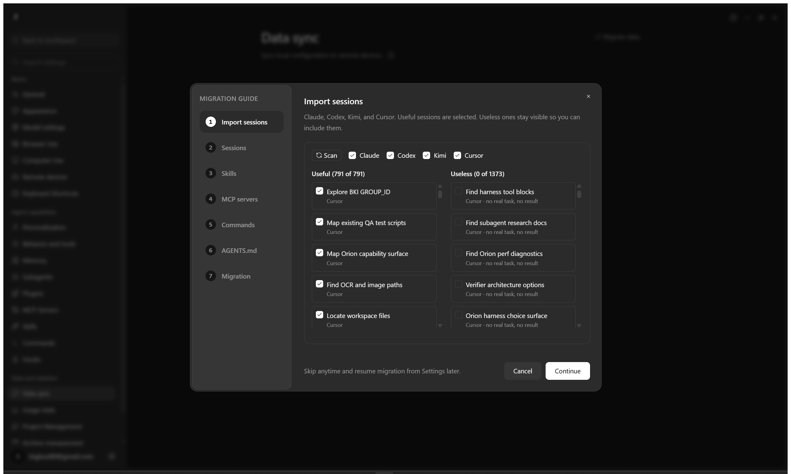
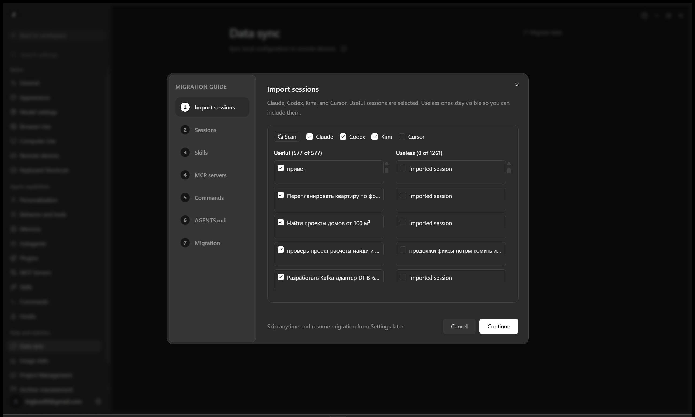
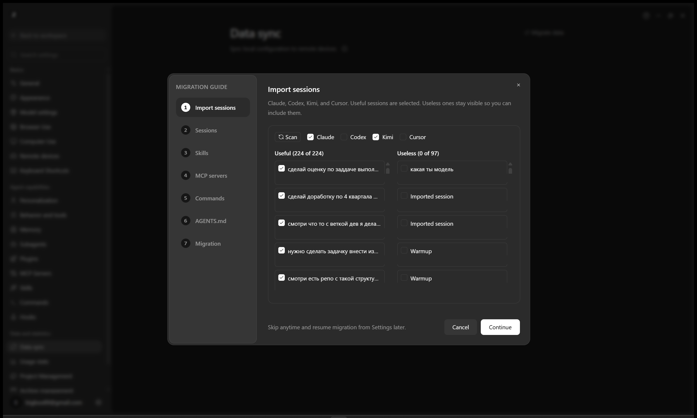

# ZCodeLocal

Локальная сборка ZCode. Отличия от Z.ai:

- Приложение запускается локально и подключается к любому провайдеру.
- Ограничение на количество вложений в сессию снято.
- Вход в систему не проверяется, телеметрия не отправляется.
- При подключении к локальному провайдеру сертификат не проверяется. У стандартных провайдеров проверка сертификата сохранена.
- Добавлен импорт сессий из Cursor, Codex и Claude. Расположение сохраняется: сессия попадает в проект исходной папки, сессии одной папки остаются в одной группе. Сканер также видит Kimi.

Импорт открывается в настройках: **Data sync → Migrate data**. Сканирование только читает локальные истории. В список попадают сессии с реальной задачей и результатом; остальные остаются в колонке «Useless» и по умолчанию не выбраны.

## Импорт сессий

Общий экран: источники Claude, Codex, Kimi и Cursor, полезные сессии отмечены.

Codex: список после сканирования.

Claude: список после сканирования.

